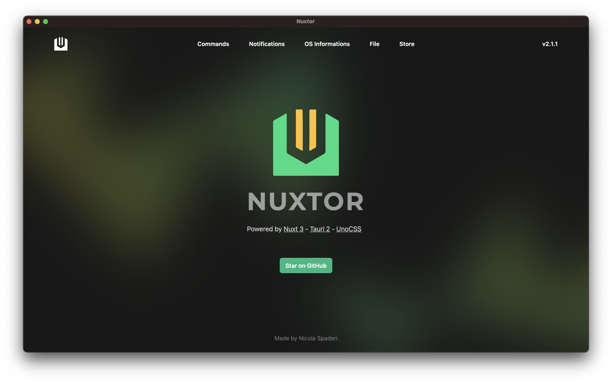

<p align="center">
  
</p>

<h1 align="center">NUXTOR</h1>

<p align="center">
  A spiritual successor of <a href="https://github.com/NicolaSpadari/vitauri">ViTauri</a>,
  built with <a href="https://nuxt.com">Nuxt 4</a> and
  <a href="https://v2.tauri.app">Tauri 2</a>.
  <br />
  Build blazing fast desktop & mobile applications.
</p>

<p align="center">
  
  
</p>

<p align="center">
  <a href="README.md">English</a> | <a href="README.zh-CN.md">简体中文</a>
</p>

<p align="center">
  
</p>

<p align="center"><strong>Powered by Nuxt 4</strong></p>

📸 **Live Previews**:  
[iOS · Android · Commands · File System · Notifications · OS Info · Storage · Webview](https://github.com/NicolaSpadari/nuxtor/blob/main/preview.md)

---

## Tech Stack

- Nuxt v4
- Tauri v2
- Nuxt UI v4
- Tailwind CSS v4
- TypeScript
- ESLint
- Auto imports (including Tauri APIs)

---

## What It Does

- Run shell commands from the app
- Send OS-level notifications
- Access system information
- Persistent key–value storage
- System tray icon
- Full Nuxt feature support (routing, layouts, middleware, modules, etc.)

---

## Who Is This For?

✅ Developers who want **Nuxt DX** in a desktop / mobile app  
✅ Teams already using **Vue / Nuxt / Tailwind**  
✅ Projects targeting **Windows / macOS / Linux / iOS / Android**  

❌ Not suitable if you require hosted SSR (SSR is intentionally disabled)

---

## Setup

> 🚀 **pnpm is the package manager** (version pinned in `packageManager`, Node version in `.nvmrc`).

- Dev server: `http://localhost:3000` (`pnpm tauri:dev` picks the next free port if busy)
- Requires the [Tauri prerequisites](https://v2.tauri.app/start/prerequisites/) (Rust ≥ 1.90)

```sh
# Scaffold a new project
npx degit NicolaSpadari/nuxtor my-nuxtor-app

cd my-nuxtor-app

# Install dependencies
pnpm install

# Start development mode
pnpm tauri:dev
```

> ⚠️ **Nuxt SSR is disabled** so Tauri can act as the backend.  
> Routing, middleware, composables, and all other Nuxt features remain fully functional.

---

## Build

```sh
pnpm tauri:build
```

Output: `src-tauri/target`

### Debug Build

```sh
pnpm tauri:build:debug
```

Enables console access inside the bundled app.

---

## iOS Development

Requires **macOS + Xcode + CocoaPods**. The Xcode project is already generated in `src-tauri/gen/apple`.

```sh
# Simulator
pnpm tauri:dev:ios

# Physical device (dev server exposed on the network)
pnpm tauri:dev:ios --host

# Open the project in Xcode
pnpm tauri:dev:ios --open

# Production build
pnpm tauri:build:ios
```

Set your team in `.env` (`APPLE_DEVELOPMENT_TEAM`, see `.env.example`) or in Xcode under **Signing & Capabilities**.

---

## Android Development

Requires **Android Studio + SDK + NDK** (`ANDROID_HOME`, `NDK_HOME` and `JAVA_HOME` set). The Gradle project is already generated in `src-tauri/gen/android`.

```sh
# Emulator or connected device
pnpm tauri:dev:android

# Open the project in Android Studio
pnpm tauri:dev:android --open

# Production build
pnpm tauri:build:android
```

> After a Tauri CLI upgrade, regenerate the mobile projects with `pnpm tauri android init` / `pnpm tauri ios init`.

---

## Notes

- Permissions live in `src-tauri/capabilities/`: `main.json` for every platform, `desktop.json` for desktop-only features (tray, menu, shell).
- Tauri APIs are auto-imported as `useTauri<Module><Function>` via `modules/tauri.ts`.
- Adding a new Tauri plugin requires registering it in `src-tauri/src/lib.rs`, in the capabilities and in this module.

---

## License

MIT © 2024–Present [Nicola Spadari](https://github.com/NicolaSpadari)
